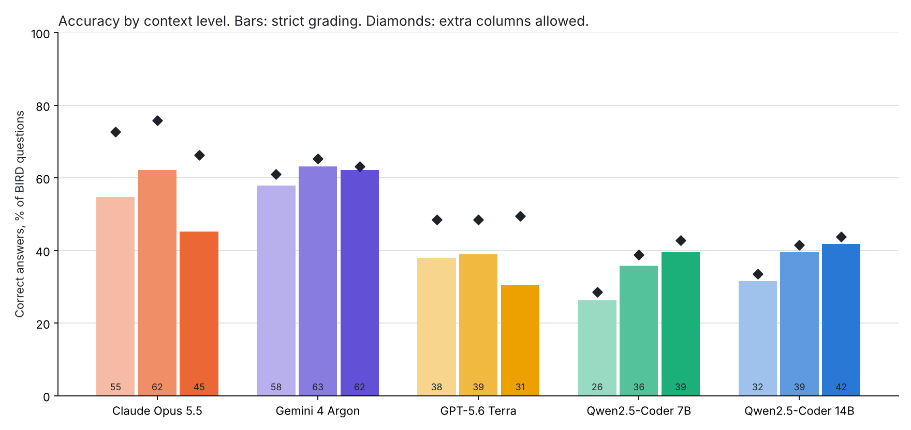
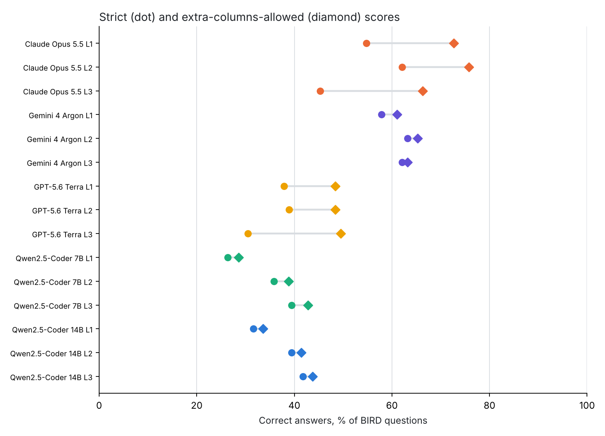

# ai-analyst-eval

> Does more context make a text-to-SQL agent more accurate? The code, the test plan and one row per run for a study of five models on BIRD Mini-Dev.

Column descriptions made two small open models about 8 to 10 points more accurate. Join rules and metric definitions that a model drafted without human review did not help reliably, and under strict grading all three frontier models scored lower with them. Strict grading also marked some right answers wrong, because it counts any extra column as an error. This repository lets you rebuild every number in the study from the results table.

## Reproduce the results

```
git clone https://github.com/altestxyz/ai-analyst-eval.git && cd ai-analyst-eval && git checkout v1.0
python3 -m venv .venv && . .venv/bin/activate && make install
make report && make verify
```

You need Python 3.10 or later. You do not need API keys or a BIRD download. `make report` reads `results/runs_table.csv`, which has one row per run (3,524 runs), and prints the tables. `make verify` checks the 84 claims in `plan/claims.json` and exits non-zero if any number differs.

## What the study found

BIRD accuracy in percent, strict scoring, rebuilt from `results/runs_table.csv`. Frontier models use the 95 questions all three finished. The small models use all 152.

| Model | L1 names | L2 + descriptions | L3 + drafted rules |
| --- | --- | --- | --- |
| Qwen2.5-Coder 7B | 26.3 | 35.9 | 39.5 |
| Qwen2.5-Coder 14B | 31.6 | 39.5 | 41.8 |
| Claude Opus 5.5 | 54.7 | 62.1 | 45.3 |
| Gemini 4 Argon | 57.9 | 63.2 | 62.1 |
| GPT-5.6 Terra | 37.9 | 38.9 | 30.5 |

- **Descriptions helped the small models.** L2 gained 9.5 points for the 7B model and 7.9 for the 14B model. Both beat the 5-point bar I set before the first run, and the 95% intervals stay above zero. Gains come from unrounded values, so they can differ by 0.1 from the rounded table.
- **Drafted rules did not help.** L3 added 2 to 4 points for the small models, which is within the noise. Under strict grading all three frontier models scored lower with it, though Gemini's 1.1-point drop is within the noise. Opus drafted the layer and lost the most: 16.8 points strict and 9.5 lenient. GPT-5.6 Terra lost 8.4 points strict and none lenient.
- **Grading rules moved scores a lot.** Allowing extra columns raised Opus by 14 to 21 points and GPT-5.6 Terra by 9 to 19. Lenient scoring turned 93 of the 425 frontier strict misses, about 22%, into correct answers.





`make report` also prints the lenient scores and redraws plain versions of Figures 1 to 4 in `docs/`. The designed charts and the hero image in the blog post are not rebuilt here.

## What this can't tell you

- It covers text-to-SQL on DuckDB, one part of an analyst's job.
- Opus drafted the only L3 layer, so a reviewed or hand-written layer is untested.
- Some BIRD answer keys are wrong, so absolute scores carry noise. Every level shares the same keys, so the comparisons hold up better than the absolute numbers.
- Each frontier model ran once on 95 questions at its default reasoning setting. This is not a vendor ranking.
- The plan in `plan/PLAN.md` is a reconstruction, not the original frozen plan. See Notes.

## How the study works

The study runs 152 questions from four BIRD Mini-Dev databases (card games, European football, Formula 1, superheroes), 30 held-out NYC taxi questions and 20 ambiguous ones. Each question is asked at three levels of context: L1 table and column names, L2 plus column descriptions (BIRD's own, and for the taxi tables descriptions adapted from the TLC data dictionary) and sample values, L3 plus join rules and metric definitions drafted by a model. Five models answer: Qwen2.5-Coder 7B and 14B at 4-bit on Ollama, and Claude Opus 5.5, Gemini 4 Argon and GPT-5.6 Terra as frontier models. A read-only DuckDB guard limits every query to 10,000 rows and 30 seconds, with three attempts per question. Each answer is scored strictly (extra columns are wrong) and leniently (extra columns are fine when every expected column is right). Gains are reported with paired bootstrap intervals and a verdict of supported, not supported or inconclusive.

One codebase runs every model. Laptop-class models go through Ollama. Frontier models go through the vendors' own APIs or through the Kaggle model proxy, chosen by one setting. The same code runs on a laptop and in a Kaggle notebook.

## Layout

| Path | What it holds |
| --- | --- |
| `aae/` | the package: data build, contexts, agent loop, guard, scoring, merge, table, rescore, figures |
| `models.yaml` | the five models, with a Kaggle-proxy route and a direct-API route for each frontier model; the file's comments explain each field |
| `experiment.yaml` | databases, quotas, repeats, attempts, seed |
| `plan/` | the test plan (a reconstruction, see Notes), the question identifiers and the claims checked by `make verify` |
| `results/` | merge manifest, results table, rescore summary |
| `docs/` | charts and tables |
| `notebooks/kaggle_run.ipynb` | the same code in a Kaggle notebook |
| `tests/` | unit tests |
| `LICENSE`, `LICENSE-DATA.md` | MIT for the code, CC BY 4.0 for `results/`, `docs/` and `plan/` |

## Install

```
git clone https://github.com/altestxyz/ai-analyst-eval.git && cd ai-analyst-eval
python3 -m venv .venv && . .venv/bin/activate
make install
cp .env.example .env
```

Python 3.10 or later. Fill in `.env` only for the routes you use. The file is ignored by git.

| Setting | Meaning |
| --- | --- |
| `AAE_ROUTE` | `auto`, `kproxy` or `direct`: how frontier models are reached (see below) |
| `MODEL_PROXY_URL`, `MODEL_PROXY_API_KEY` | the Kaggle model proxy, supplied inside a Kaggle benchmark-task notebook |
| `ANTHROPIC_API_KEY`, `GEMINI_API_KEY`, `OPENAI_API_KEY` | vendor keys for the direct route |
| `OLLAMA_HOST_URL` | Ollama address, default `http://127.0.0.1:11434` |
| `SPEND_CAP_USD` | stops a run at this estimated cost, default 300 |
| `BIRD_DIR`, `AAE_DATA` | where BIRD Mini-Dev is read from and where `make setup` writes data, default `data/` |
| `AAE_PROXY_MODE` | `openai` (default) calls the proxy as an OpenAI-compatible endpoint; `sdk` uses the `kaggle_benchmarks` package inside Kaggle |
| `KAGGLE_USERNAME`, `KAGGLE_KEY` or `KAGGLE_API_TOKEN` | only for saving shards to a private Kaggle dataset |
| `AAE_SHARDS_DATASET`, `AAE_KAGGLE_USER` | name and owner of that dataset, default `aae-shards` and the signed-in user |
| `AAE_BIG`, `AAE_SEMANTIC_AUTHOR`, `AAE_LAPTOP_MARGIN` | report options: the reference frontier model (default `F1`), the model that drafted L3, and the laptop margin in points (default 5) |

## Run the small models on a laptop

1. Install [Ollama](https://ollama.com) and pull the models: `ollama pull qwen2.5-coder:7b`, `ollama pull qwen2.5-coder:14b`. The 14B model needs about 16 GB of memory at 4-bit.
2. Download BIRD Mini-Dev, which holds `mini_dev_sqlite.json` and `dev_databases/`, and point to it with `BIRD_DIR`, or let `make setup` download it into `data/`.
3. Run:

```
make doctor TARGET=laptop
make setup
make freeze
make run-laptop
```

`make setup` builds the DuckDB copies, checks the answer keys against the SQLite originals, selects the questions and writes the three context levels. It skips the taxi set, whose questions and column descriptions are not in this repository, so a new run covers the 152 BIRD questions. L3 is drafted by a frontier model, so the context step needs one frontier credential; run `python -m aae contexts --author manual` and write `contexts/<database>/semantic.yaml` by hand instead.

## Run the frontier models

`AAE_ROUTE` chooses the route. `auto` uses the Kaggle proxy when `MODEL_PROXY_URL` and `MODEL_PROXY_API_KEY` are both set and the vendors' APIs otherwise. `direct` and `kproxy` force one.

Direct APIs: set `ANTHROPIC_API_KEY`, `GEMINI_API_KEY` and `OPENAI_API_KEY` in `.env`, then

```
make doctor TARGET=frontier
make smoke TARGET=frontier
make run-frontier
```

`SPEND_CAP_USD` (default 300) stops a run when its estimated cost reaches the cap. The direct model identifiers and base URLs in `models.yaml` are the ones to check first if a call fails; they follow each vendor's OpenAI-compatible endpoint.

Kaggle: open `notebooks/kaggle_run.ipynb`, read the header cell and run it. The notebook installs this package, restores saved sessions, runs the slice for the day with `python -m aae shard` and publishes new records to a private dataset.

To run both targets from one machine, `make run-laptop` and `make run-frontier` write to the same `runs/runs.jsonl`. Runs are keyed by `question|level|model|repeat`, so a restarted run skips what is done.

## Merge several runs of one plan

A plan is rarely finished in one session. Copy the run logs from every session, laptop and frontier alike, into one folder and merge them:

```
make merge PLAN_DIR=plan_runs
make table RESCORED=path/to/rescored.json SHAPES=path/to/shape.jsonl
```

The merge reads every run log under the folder, keeps one record per run id, counts identical copies once and reports any copies that disagree. `--prefer latest` keeps the newest copy on a conflict; the default keeps the first. It also compares the plan fingerprints that the sessions carry and warns if they differ. `results/merge_manifest.json` records each input file with its checksum and counts. `RESCORED` and `SHAPES` are optional. `make rescore` writes the first, and `python -m aae diagnose backfill` writes `labels/shape.jsonl`, which is the second.

The published plan merged six logs: three frontier sessions (809, 1,100 and 1,100 records, the last two identical) and three logs from the small-model sessions on a Kaggle GPU (1,500, 1,500 and 1,733 records; the first two are identical and also hold the 809 earlier frontier records). That is 7,742 records read, 3,524 unique runs and no conflicts. The manifest lists the checksum of each file, so you can check that your copies of the logs are the same ones.

To pick up saved Kaggle sessions instead, use `python -m aae restore --from <folder> --to .`.

## Rebuild the numbers

With only this repository:

```
make report
make verify
```

`make report` reads `results/runs_table.csv`, which has one row per run and holds no SQL text and no answer keys. `make verify` exits non-zero if any quoted number differs from the table.

To go back one step, put the raw run logs in a folder and run `make merge`, `make rescore` and `make table`. Rescoring needs the DuckDB copies and the answer keys, so it needs BIRD Mini-Dev and `make setup`.

## Clean up

To remove the downloaded repository and everything `make install` put in its virtual environment, run this from the repository folder:

```
deactivate
cd ..
rm -rf ai-analyst-eval
```

This permanently deletes the folder, including any `.env`, data, run logs or edits inside it. Copy anything you want to keep first.

This covers the setup in "Reproduce the results". It doesn't remove Python, pip's download cache, Ollama or its pulled models, or data you stored outside the folder through BIRD_DIR or AAE_DATA. To remove the two small models too:
```
ollama rm qwen2.5-coder:7b qwen2.5-coder:14b
```

## Not published

- The raw run logs, which contain model-generated SQL.
- The BIRD databases and the answer keys. BIRD Mini-Dev is licensed CC BY-SA 4.0 on the official site; check the terms before reuse.
- Question text. `plan/question_ids.json` lists identifiers only. The 30 taxi and 20 ambiguous questions and the taxi column descriptions are not included either, so the taxi results can be recomputed from `results/runs_table.csv` but not rerun.

## Data, attribution and licence

- Code: MIT, see `LICENSE`. Results table, charts and plan: CC BY 4.0, see `LICENSE-DATA.md`. Neither contains BIRD question text, SQL, answer keys or database content, so BIRD's share-alike terms are not triggered. If you add any of that material, license the file CC BY-SA 4.0 and mark it.
- BIRD: Li, J., Hui, B., Qu, G., et al. (2023). Can LLM Already Serve as A Database Interface? A BIg Bench for Large-Scale Database Grounded Text-to-SQLs. NeurIPS 2023. Paper <https://arxiv.org/abs/2305.03111>, leaderboard and data <https://bird-bench.github.io/>. BIRD Mini-Dev is used under CC BY-SA 4.0 and is downloaded from the official source, not redistributed here.
- NYC TLC Trip Record Data (yellow taxi trips, January to March 2025), published by the New York City Taxi and Limousine Commission and downloaded from the TLC's own files in November 2026. It is not redistributed here.
- Qwen2.5-Coder and Qwen2.5 are run locally through Ollama. Check each model's own licence before redistributing weights.
- The software and results are provided as is, with no warranty.
- This is independent work. It is not affiliated with or endorsed by BIRD or its authors, the NYC TLC, Kaggle, Ollama, Alibaba Cloud, Anthropic, Google or OpenAI. Model names identify what was tested. This is not a vendor ranking. 

## Notes

- Before the first run, `python -m aae freeze write` stored a hash of the experiment settings, model list, prompt file, question list and contexts, and `run` refuses to start if any of them has changed since (`--allow-changes` overrides this). The prompt hash covers the bytes of `aae/prompts.py`. Comments were removed from the source after that run, so this repository does not reproduce those hashes. `plan/PLAN.md` is a reconstruction of the plan from the committed configuration and the Kaggle session notes. Run `python -m aae freeze write` before any new run to freeze your own plan.
- Frontier models ran at their default reasoning setting, which differs between vendors. The results are not a vendor ranking.
- `CHANGELOG.md` lists changes, including the two harness changes made after the first partial run.

## Tests

```
make test
make lint
```
